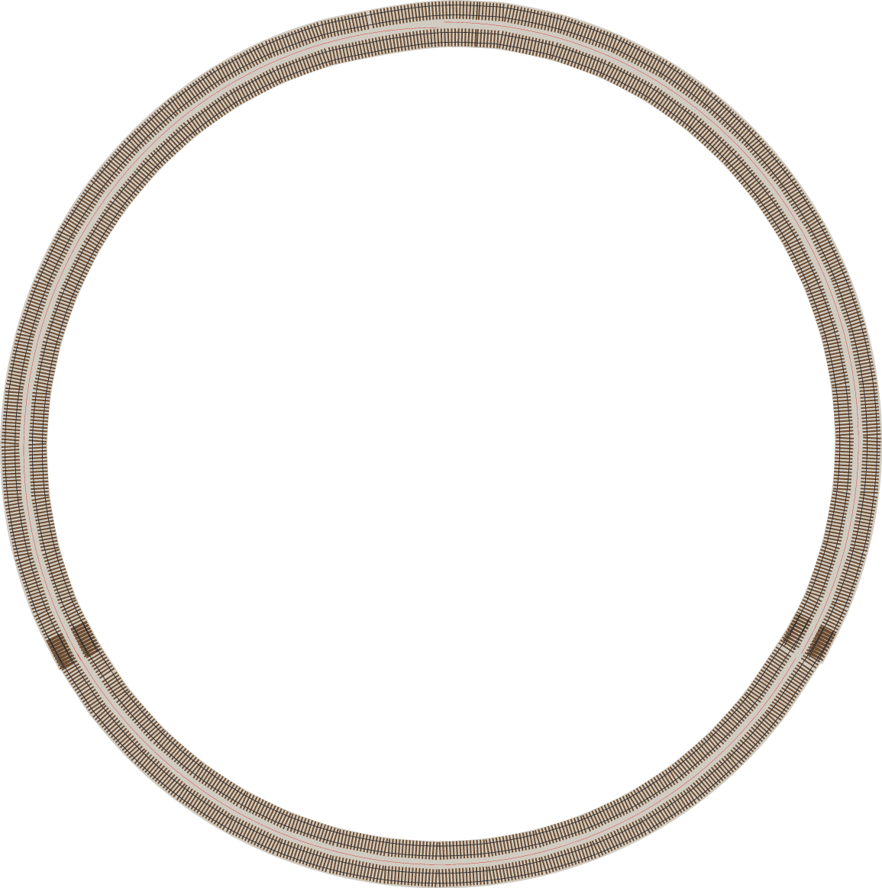
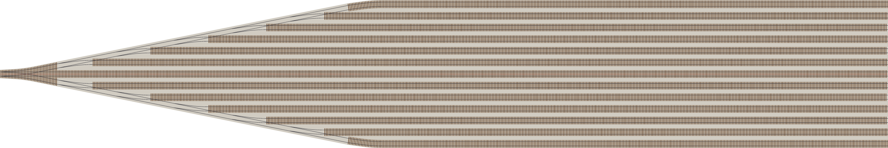
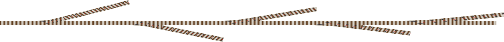
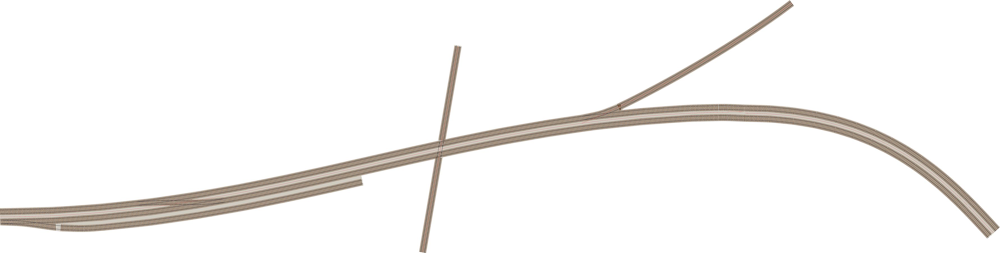
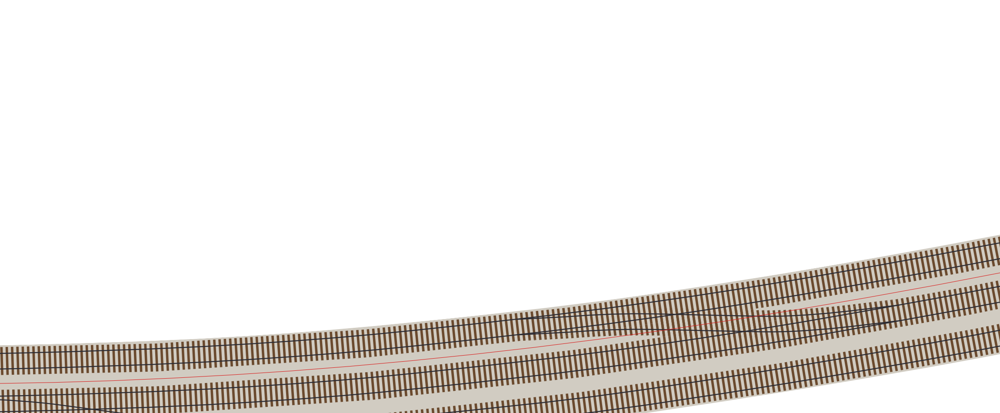
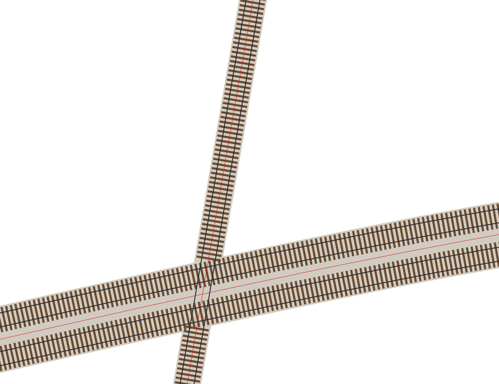
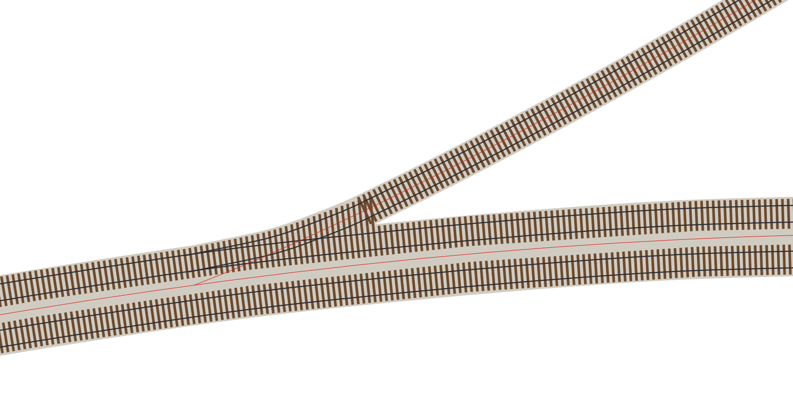

# Gallery

Four layouts that use the whole system. Each is a handful of drawn lines (`examples/rail/*.json`, in the format `scripts/render.mjs` reads) and one-line descriptions; everything you see is built by the plug-in from those. Re-render them with `node scripts/gallery.mjs <vectorcraft-cli> <path to vectorcraft-cli>` (headless: it never touches an open document).

Budget: the plug-in has about 21 M of "fuel" to build a document (see `CLAUDE.md`). Measured with `tools/fuel` in Track Layer: oval 6.6 M, terminal 10.6 M, turnouts 7.1 M, station 8.8 M. Cartographer spends 15 to 30% more on rail ([PARITY-RAIL.md](PARITY-RAIL.md)): oval 7.9 M, terminal 13.6 M, turnouts 8.2 M, station 10.6 M, all well inside the limit.

## 1. An oval from three sloppy curves

`examples/rail/oval.json`

Three curves, each a Bézier arc of 120 degrees, each **drawn a few millimetres off** at its start (4 to 6 mm, and a few degrees out of tangent) the way hand-drawn lines are. Three joints say what happens at each meeting: *"they join end to end"*. Each line is trimmed back just enough and a smooth connector, tangent to both, makes the ring one continuous double track. Nothing in the drawn lines was changed.



## 2. An engine terminal

`examples/rail/terminal.json`: *"A single track enters a terminal with six stub tracks to the left and six to the right, number 5 turnouts."*

```json
{"mains": 1, "left": 6, "right": 6, "frog": 5, "ends": "stub"}
```

One lead, 12 turnouts and 12 spurs, 13 tracks side by side: every turnout the NMRA RP-12.35 No. 5 (11.4 degrees), the spurs spaced at the RP-7.2 13 ft centres (24.8 mm), thousands of ties and the roadbed all from that one line. It needs about 0.8 m of line before the spurs run parallel; shorter and the plug-in says by how much.



## 3. A catalogue of NMRA turnouts

`examples/rail/turnouts.json`: *"b is a siding off a with a number 8 turnout"*, five times.

Turnouts No. 4, 5, 6, 8 and 10 off one main, on alternating sides, each branch drawn at that frog's angle (14.25, 11.42, 9.53, 7.15 and 5.73 degrees). Each is the RP-12.35 shape for its number: its own switch rail length, closure radius and lead, so the gentler the frog the longer the turnout. The connector from each turnout's leg into the drawn branch line is nearly straight because the drawn angle matches.



## 4. A junction station

`examples/rail/station.json`

A curved (Bézier) double track with four other lines and three joints, described in words: *"double track with a crossover in the middle and a siding on the right; a line crosses it; a siding off it with a turnout; it continues."*

```json
m: {"mains": 2, "right": 1, "length": 900, "crossovers": [{"from": 1, "to": 2}]}
x: {"tracks": 1}          joint m-x: {"kind": "crossing", "main": "m"}
b: {"tracks": 1}          joint m-b: {"kind": "branch"}
n: {"tracks": 2}          joint m-n: {"kind": "join"}
```



At the left, a passing siding leaves the right-hand main with an NMRA No. 6 ladder and a crossover joins the two mains in the middle of the first 900 mm; both follow the curve.



A single track crosses the curved double track at about 70 degrees. The double track runs through with all its ties; the crossing track's ties stop at the edge of its strip and its rails cross over.



A branch line leaves the left main. The program chose the turnout number that gives the gentlest connection, put the turnout on the main's outer left track, and bent the branch's last stretch into the line that was drawn (the thin red line is the drawn line). The main gets lengthened switch ties; the branch's own ties start where they would no longer overlap.



At the right, the double track continues into a second curve that was drawn 5 mm off; the join trims both back and carries both tracks across smoothly.

## What this shows

- **Words to track.** Every layout above is a few short descriptions; the plain-words panel turns sentences like those quoted into the same JSON.
- **NMRA-based geometry.** Gauge from S-3.2, turnouts from the RP-12.35 table, spacing from RP-7.1 and RP-12, radius floor from RP-11.
- **Lines mesh.** Crossings, branches and joins find each other from the drawing, within 30 mm, tell you what they found, and are rebuilt every time you move a line.
- **True curves.** Rails and roadbed are real Bézier curves; ties stay square to the track on every curve.
- **A budget you can see.** Each build stays well inside the plug-in's limit; ties beyond it fall back to a solid strip with a note.
